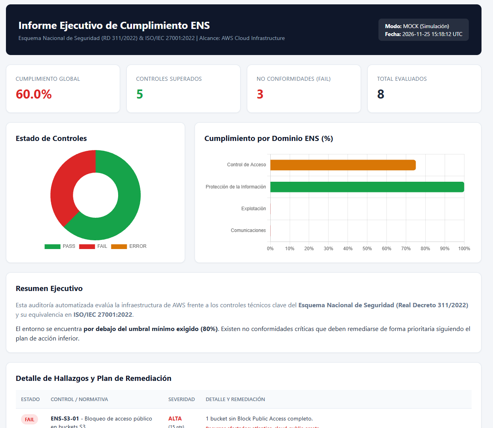
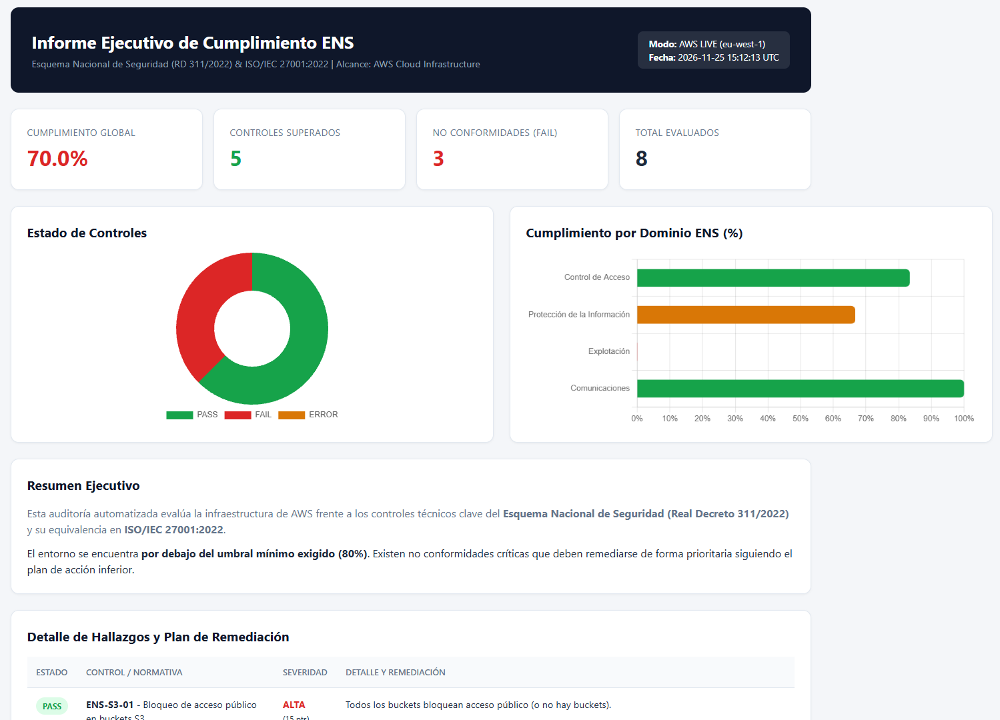
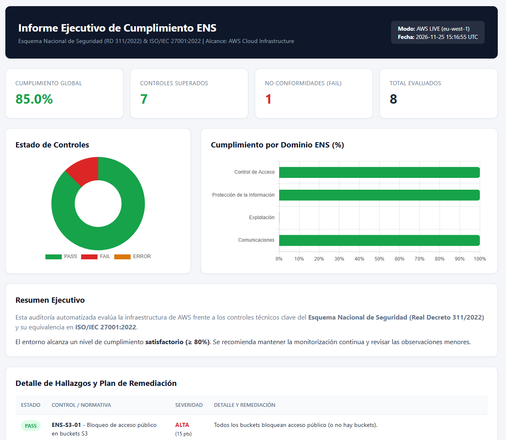

# 🛡️ ENS-Cloud-Auditor

[](https://github.com/danielbarbeytotorres/ENS-Cloud-Auditor/actions)
-3776AB?logo=python&logoColor=white)


**Plataforma de Gobierno, Riesgo y Cumplimiento (GRC) y *Compliance-as-Code* para entornos AWS**, mapeada al **Esquema Nacional de Seguridad (Real Decreto 311/2022)** y a **ISO/IEC 27001:2022**.



---

## 🎯 Objetivo del Proyecto
**ENS-Cloud-Auditor** automatiza la auditoría técnica de seguridad en **Amazon Web Services (AWS)**, traduciendo configuraciones erróneas de infraestructura (S3, IAM, CloudTrail, VPC/EC2, EBS) en indicadores ejecutivos de cumplimiento legal y riesgo corporativo. A diferencia de un script técnico aislado, integra la capa documental completa de gobernanza (**Política de Seguridad de la Información, Declaración de Aplicabilidad y Matriz de Riesgos MAGERIT v3**) junto con una puerta de calidad **DevSecOps en CI/CD**.

## 🎬 Demostración en Ejecución
> **Vídeo de demostración (`docs/demo.mp4`):** Ejecución del auditor por CLI (`--mock`), evaluación ponderada de controles ENS y generación del dashboard ejecutivo HTML con comandos de remediación AWS CLI.  
> 📹 *[Ver / Descargar `docs/demo.mp4`](docs/demo.mp4)*

---

## 📊 Cobertura Normativa Cuantificada
El motor evalúa **8 controles técnicos automatizados** sobre **5 servicios principales de AWS** (más **1 control físico heredado** documentado en la SoA), ponderados según su criticidad:

* **Esquema Nacional de Seguridad (RD 311/2022 — Categoría: MEDIA):**
  * Cubre **7 medidas de seguridad** repartidas en **4 dominios del ENS**:
    * **Control de Acceso (`op.acc` — 35% del peso):** `op.acc.2` (Bloqueo de acceso público en S3), `op.acc.4` (Prohibición de políticas IAM gestionadas o *inline* con permisos `*:*`), `op.acc.5` (MFA en cuenta Root y usuarios IAM con consola + política de contraseñas ≥ 14 caracteres).
    * **Protección de la Información (`mp.info` — 35% del peso):** `mp.info.1` (Prevención de exposición pública), `mp.info.3` (Cifrado gestionado con AWS KMS en buckets S3 y cifrado por defecto en volúmenes EBS).
    * **Explotación (`op.exp` — 15% del peso):** `op.exp.8` (Registro de actividad CloudTrail activo y multirregión).
    * **Comunicaciones (`mp.com` — 15% del peso):** `mp.com.1` (Cierre de puertos SSH/RDP y reglas de tráfico total `-1` expuestas a `0.0.0.0/0` o `::/0`).
    * **Instalaciones e Infraestructuras (`mp.if` — Heredado):** `mp.if.1` (Seguridad física de centros de datos heredada de la certificación ENS Alta de AWS).
* **Anexo A de ISO/IEC 27001:2022:**
  * Mapea directamente **9 de los 93 controles del Anexo A (9,7% de cobertura global)**, cubriendo el **17,6% (6/34)** del bloque de Controles Tecnológicos (`A.5.15`, `A.5.17`, `A.7.1`, `A.8.2`, `A.8.3`, `A.8.5`, `A.8.15`, `A.8.20`, `A.8.24`).

---

## 🔬 Caso de Estudio Real en AWS: Antes y Después (`eu-west-1`)
Para validar la detección y remediación en un entorno real, se ejecutó la herramienta contra una cuenta AWS en `eu-west-1` mediante un usuario auditor de mínimo privilegio (`SecurityAudit`):

| Fase de Auditoría | Puntuación ENS | Superados / Fallidos | Hallazgos y Acciones Aplicadas |
| :--- | :---: | :---: | :--- |
| **1. Estado Inicial (`AWS LIVE`)** | **70,0%** ❌ | 5 PASS / 3 FAIL | Por debajo del umbral del 80%. Detectada política de contraseñas débil (`ENS-IAM-02`), cifrado EBS por defecto desactivado (`ENS-EBS-01`) y ausencia de CloudTrail multirregión (`ENS-CT-01`). |
| **2. Post-Remediación (`AWS LIVE`)** | **85,0%** ✅ | 7 PASS / 1 FAIL | **Umbral superado (≥ 80%).** Remediación a coste cero vía AWS CLI en IAM y EBS, elevando al **100%** los dominios de *Control de Acceso* y *Protección de la Información*. |

| Antes de la Remediación (`70,0%` — No Conforme) | Después de la Remediación (`85,0%` — Conforme) |
| :---: | :---: |
|  |  |

---

## ✨ Características Principales
* **Escáner AWS Blindado (`boto3`):** Paginación completa en S3, IAM y EC2; inspecciona políticas IAM gestionadas e *inline* (usuarios, grupos y roles), MFA en usuarios con consola, cifrado con AWS KMS, Security Groups IPv4/IPv6 y reglas de tráfico total `-1`. Incluye modo `--mock` para demostraciones sin credenciales.
* **Reglas Normativas Desacopladas (`config/ens_controls.json`):** Catálogo ponderado independiente del código de escaneo.
* **Reporting Ejecutivo Multiformato:** Genera simultáneamente un **Dashboard HTML** (Jinja2 con autoescape XSS + gráficas *Chart.js* por dominio), **exportación CSV** (delimitada por `;` para Excel/GRC) y **salida JSON** para integración con SIEM/SOAR.
* **Puerta de Calidad DevSecOps (`.github/workflows/`):** Ejecuta tests unitarios con `pytest`, análisis estático IaC con `Checkov` sobre Terraform y bloquea el pipeline si el cumplimiento baja del `--threshold` configurado (`80%` por defecto).

## 📂 Arquitectura del Repositorio
```text
ENS-Cloud-Auditor/
├── .github/workflows/   # Pipeline CI/CD (pytest, análisis IaC Checkov y umbral ENS)
├── config/              # Catálogo desacoplado de controles ENS (RD 311/2022) e ISO 27001
├── docs/                # Vídeo demo, evidencias reales AWS y documentación GRC
│   └── governance/      # Política de Seguridad (PSI), SoA y Matriz de Riesgos MAGERIT v3
├── infra/               # Código Terraform de demostración (IaC)
├── src/                 # Motor Python, escáneres boto3 blindados, CLI y generador de informes
├── templates/           # Plantilla Jinja2 con autoescape para el dashboard ejecutivo HTML
├── tests/               # Suite automatizada pytest (scoring, dominios, XSS, IAM)
└── requirements.txt     # Dependencias Python fijadas

## 🛠️ Stack Técnico y Versiones
* **Entorno:** Python `3.11+` (verificado en `Python 3.14.7`)
* **Librerías Principales:** `boto3 >= 1.34`, `Jinja2 >= 3.1`, `colorama >= 0.4`
* **Testing y DevSecOps:** `pytest 9.2.0`, `Checkov`, `Terraform`, `GitHub Actions`

## 🚀 Instalación y Uso Rápido

### 1. Clonar el repositorio e instalar dependencias
```bash
git clone [https://github.com/danielbarbeytotorres/ENS-Cloud-Auditor.git](https://github.com/danielbarbeytotorres/ENS-Cloud-Auditor.git)
cd ENS-Cloud-Auditor
python -m venv venv
# Windows: .\venv\Scripts\Activate.ps1 | Linux/Mac: source venv/bin/activate
pip install -r requirements.txt
```

### 2. Ejecutar en modo simulación (`--mock`)
```bash
python -m src.main --mock
```

### 3. Ejecutar contra AWS real y lanzar tests
```bash
python -m src.main --region eu-west-1 --threshold 80
python -m pytest -v
```
Los informes se generan automáticamente en `output/audit_report.html`, `output/audit_report.csv` y `output/audit_results.json`.

## 📄 Documentación de Gobernanza (Caso de Uso)
* [Política de Seguridad de la Información — PSI (`01_Politica_Seguridad_Informacion.md`)](docs/governance/01_Politica_Seguridad_Informacion.md)
* [Declaración de Aplicabilidad — SoA (`02_Declaracion_Aplicabilidad_SoA.md`)](docs/governance/02_Declaracion_Aplicabilidad_SoA.md)
* [Matriz de Análisis de Riesgos — MAGERIT v3 (`03_Analisis_Riesgos_MAGERIT.md`)](docs/governance/03_Analisis_Riesgos_MAGERIT.md)

---
Desarrollado por **Daniel Barbeyto Torres** | Ingeniería Informática & Ciberseguridad