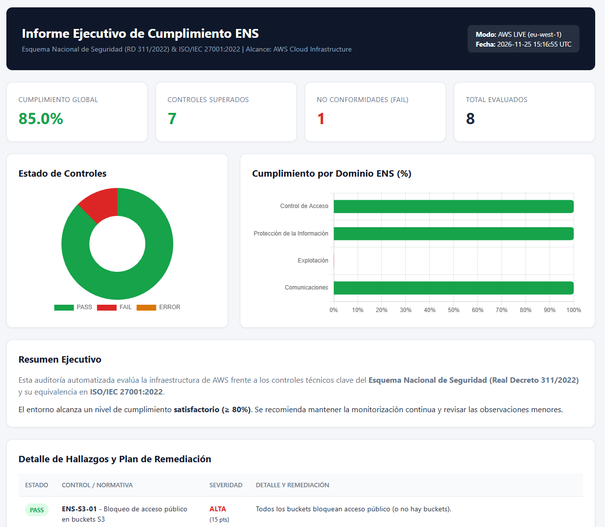

🇬🇧 **English** | 🇪🇸 [Español](README.es.md)

# 🛡️ ENS-Cloud-Auditor

[](https://github.com/danielbarbeytotorres/ENS-Cloud-Auditor/actions)
-3776AB?logo=python&logoColor=white)


**Governance, Risk & Compliance (GRC) and Compliance-as-Code framework for AWS environments**, mapped to **Spain's National Security Framework — Esquema Nacional de Seguridad (Royal Decree 311/2022)** and **ISO/IEC 27001:2022**.


---

## 🎯 Project Overview
**ENS-Cloud-Auditor** automates technical security auditing across **Amazon Web Services (AWS)**, translating low-level cloud misconfigurations (S3, IAM, CloudTrail, VPC/EC2, EBS) into executive compliance scores and risk metrics. Unlike standalone scripts, it bridges technical engineering and GRC governance by shipping with a complete, aligned documentation suite (**Information Security Policy, Statement of Applicability, and MAGERIT v3 Risk Matrix**) and a **DevSecOps CI/CD quality gate**.

## 🎬 Live Execution Demo
> **Demo walkthrough (`docs/demo.mp4`):** Running the auditor CLI (`--mock`), evaluating weighted ENS controls, and rendering the interactive HTML executive dashboard with AWS CLI remediation commands.  
> 📹 *[Watch / Download `docs/demo.mp4`](docs/demo.mp4)*

---

## 📊 Quantified Regulatory Coverage
The engine evaluates **8 automated technical controls** across **5 core AWS services** (plus **1 inherited physical control** documented in the SoA), weighted by risk severity:

* **Esquema Nacional de Seguridad (RD 311/2022 — Category: MEDIUM):**
  * Covers **7 technical measures** across **4 ENS domains**:
    * **Access Control (`op.acc` — 35% weight):** `op.acc.2` (S3 Block Public Access), `op.acc.4` (No `*:*` managed or inline IAM policies), `op.acc.5` (MFA on Root & console IAM users + ≥14-char password policy).
    * **Information Protection (`mp.info` — 35% weight):** `mp.info.1` (Public exposure prevention), `mp.info.3` (AWS KMS encryption on S3 buckets & default EBS volume encryption).
    * **Operations (`op.exp` — 15% weight):** `op.exp.8` (Active multi-region CloudTrail logging).
    * **Communications (`mp.com` — 15% weight):** `mp.com.1` (No SSH/RDP ports or `-1` all-traffic rules exposed to `0.0.0.0/0` or `::/0`).
    * **Facilities (`mp.if` — Inherited):** `mp.if.1` (Physical datacenter security inherited from AWS ENS High certification).
* **ISO/IEC 27001:2022 Annex A:**
  * Maps directly to **9 of 93 Annex A controls (9.7% overall coverage)**, targeting **17.6% (6/34)** of the Technological Controls domain (`A.5.15`, `A.5.17`, `A.7.1`, `A.8.2`, `A.8.3`, `A.8.5`, `A.8.15`, `A.8.20`, `A.8.24`).

---

## 🔬 Real AWS Case Study: Before & After Remediation (`eu-west-1`)
To validate real-world detection and remediation, the auditor was executed against a live AWS account in `eu-west-1` using a least-privilege read-only IAM auditor role (`SecurityAudit`):

| Audit Phase | Compliance Score | Passed / Failed | Key Findings & Actions |
| :--- | :---: | :---: | :--- |
| **1. Initial Baseline (`AWS LIVE`)** | **70.0%** ❌ | 5 PASS / 3 FAIL | Below the 80% threshold. Detected weak IAM password policy (`ENS-IAM-02`), disabled default EBS encryption (`ENS-EBS-01`), and missing multi-region CloudTrail (`ENS-CT-01`). |
| **2. Post-Remediation (`AWS LIVE`)** | **85.0%** ✅ | 7 PASS / 1 FAIL | **Threshold passed (≥ 80%).** Applied zero-cost AWS CLI remediations for IAM password policy and EBS default encryption, bringing *Access Control* and *Information Protection* to **100%**. |

| Before Remediation (`70.0%` — Non-Compliant) | After Remediation (`85.0%` — Compliant) |
| :---: | :---: |
|  |  |

---

## ✨ Key Capabilities
* **Hardened AWS Scanner (`boto3`):** Full API pagination across S3, IAM, and EC2; inspects managed and inline IAM policies (users, groups, roles), console-enabled IAM user MFA, AWS KMS encryption, IPv4/IPv6 Security Groups, and `-1` all-traffic rules. Includes `--mock` mode for offline demos.
* **Decoupled Compliance Rules (`config/ens_controls.json`):** Weighted control catalog decoupled from scanner logic for effortless updates.
* **Multi-Format Executive Reporting:** Simultaneously generates an **HTML Dashboard** (Jinja2 with XSS autoescape + Chart.js domain breakdown), **CSV export** (`;` delimited for Excel/GRC tools), and **JSON output** for SIEM/SOAR ingestion.
* **DevSecOps CI/CD Gate (`.github/workflows/`):** Runs `pytest` unit tests, `Checkov` IaC static analysis on Terraform, and fails builds if compliance drops below `--threshold` (default `80%`).

## 📂 Repository Architecture
```text
ENS-Cloud-Auditor/
├── .github/workflows/   # CI/CD pipeline (pytest, Checkov IaC scan & compliance gate)
├── config/              # Decoupled ENS (RD 311/2022) & ISO 27001:2022 control catalog
├── docs/                # Demo video, live AWS before/after evidence & GRC governance suite
│   └── governance/      # Information Security Policy (PSI), SoA & MAGERIT v3 Risk Matrix
├── infra/               # Terraform Infrastructure-as-Code test environment
├── src/                 # Core engine, hardened boto3 scanners, CLI & report generator
├── templates/           # Auto-escaped Jinja2 template for the HTML executive dashboard
├── tests/               # Automated pytest suite (scoring, domain breakdown, XSS, IAM)
└── requirements.txt     # Pinned Python dependencies
```

## 🛠️ Tech Stack & Versions

* Runtime: Python `3.11+` (verified on Python `3.14.7`)
* Core Libraries: `boto3 >= 1.34`, `Jinja2 >= 3.1`, `colorama >= 0.4`
* Testing & DevSecOps: `pytest 9.2.0`, `Checkov`, `Terraform`, `GitHub Actions`

## 🚀 Quick Start

### 1. Clone & Install Dependencies

```bash
git clone [https://github.com/danielbarbeytotorres/ENS-Cloud-Auditor.git](https://github.com/danielbarbeytotorres/ENS-Cloud-Auditor.git)
cd ENS-Cloud-Auditor
python -m venv venv
# Windows: .\venv\Scripts\Activate.ps1 | Linux/Mac: source venv/bin/activate
pip install -r requirements.txt
```

### 2. Run Offline Simulation (`--mock`)

```bash
python -m src.main --mock
```

### 3. Run Live AWS Audit & Unit Tests

```bash
python -m src.main --region eu-west-1 --threshold 80
python -m pytest -v
```
Generated reports are saved automatically to output/audit_report.html, output/audit_report.csv, and output/audit_results.json.

## 📄 GRC Governance Suite (Reference Case Study)

* [Information Security Policy — PSI (`01_Politica_Seguridad_Informacion.md`)](docs/governance/01_Politica_Seguridad_Informacion.md)
* [Statement of Applicability — SoA (`02_Declaracion_Aplicabilidad_SoA.md`)](docs/governance/02_Declaracion_Aplicabilidad_SoA.md)
* [MAGERIT v3 Risk Analysis Matrix (`03_Analisis_Riesgos_MAGERIT.md`)](docs/governance/03_Analisis_Riesgos_MAGERIT.md)

---
Developed by **Daniel Barbeyto Torres** | Computer Engineering & Cybersecurity