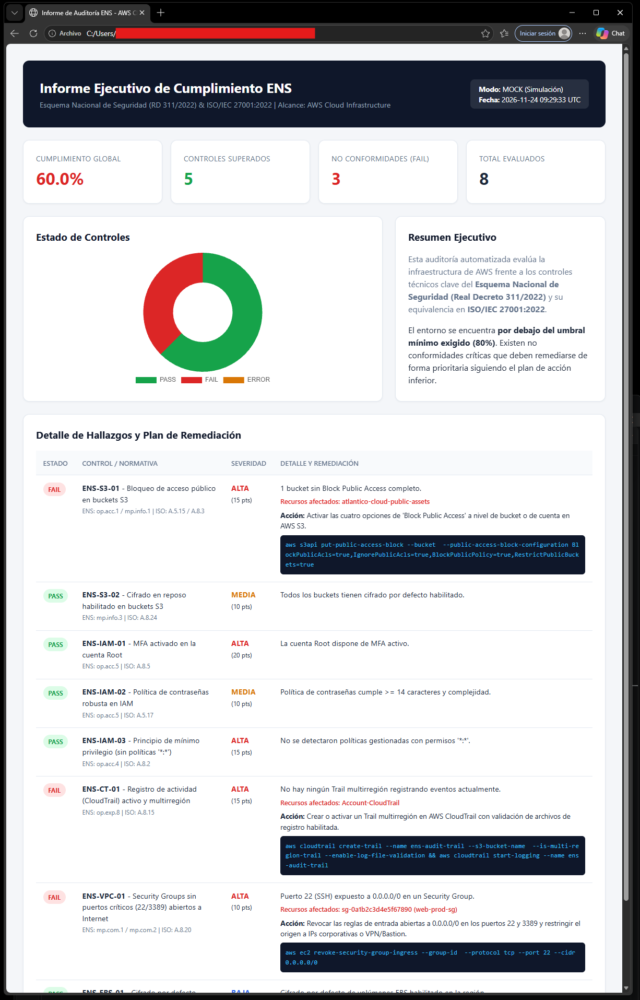

# 🛡️ ENS-Cloud-Auditor

**Plataforma de Gobierno, Riesgo y Cumplimiento (GRC) y *Compliance-as-Code* para entornos AWS**, mapeada al **Esquema Nacional de Seguridad (Real Decreto 311/2022)** y a **ISO/IEC 27001:2022**.



## 🎯 Objetivo del Proyecto
Automatizar la auditoría técnica de infraestructura en **Amazon Web Services (AWS)** traduciendo hallazgos técnicos (S3, IAM, CloudTrail, VPC, EBS) en métricas ejecutivas de cumplimiento legal y riesgo corporativo. Incluye la capa documental completa de gobernanza (PSI, Declaración de Aplicabilidad y Análisis de Riesgos MAGERIT) e integración en CI/CD.

## ✨ Características Principales
* **Motor de Auditoría AWS (`boto3`):** Evalúa controles críticos de seguridad en tiempo real + modo `--mock` para demostraciones sin credenciales.
* **Mapeo Normativo Desacoplado (`config/ens_controls.json`):** Reglas ponderadas vinculadas directamente a códigos oficiales del ENS (`op.acc`, `op.exp`, `mp.info`, `mp.com`) e ISO 27001:2022.
* **Reporting Ejecutivo Automatizado:** Generación simultánea de:
  * **Dashboard HTML interactivo** (con gráficas *Chart.js* y comandos de remediación AWS CLI).
  * **Exportación CSV** lista para Excel/herramientas GRC.
  * **Salida estructurada en JSON** para integración con SIEM/SOAR.
* **Capa Documental GRC (`/docs/governance`):** Política de Seguridad de la Información (PSI), Declaración de Aplicabilidad (SoA) y Matriz de Riesgos bajo metodología **MAGERIT v3**.
* **Puerta de Calidad DevSecOps (GitHub Actions):** Bloquea despliegues si la puntuación de cumplimiento cae por debajo del umbral configurado (por defecto, 80%).

## 📂 Arquitectura del Repositorio
```text
ENS-Cloud-Auditor/
├── .github/workflows/   # Pipeline CI/CD de cumplimiento continuo
├── config/              # Mapeo de controles ENS (RD 311/2022) e ISO 27001
├── docs/governance/     # Documentación GRC (PSI, SoA, Análisis MAGERIT)
├── infra/               # Código Terraform de demostración (IaC)
├── src/                 # Motor Python, escáneres AWS (boto3) y generador de informes
├── templates/           # Plantilla Jinja2 para el informe ejecutivo HTML
└── output/              # Informes generados (HTML, CSV, JSON)
```

# 🚀 Instalación y Uso Rápido

## 1. Clonar el repositorio e instalar dependencias:

```bash
git clone [https://github.com/danielbarbeytotorres/ENS-Cloud-Auditor.git](https://github.com/danielbarbeytotorres/ENS-Cloud-Auditor.git)
cd ENS-Cloud-Auditor
python -m venv venv
# Windows: .\venv\Scripts\Activate.ps1 | Linux/Mac: source venv/bin/activate
pip install -r requirements.txt
```

## 2. Ejecutar en modo simulación (sin necesidad de cuenta AWS):

```bash
python -m src.main --mock
```

## 3. Ejecutar contra una cuenta real de AWS (requiere AWS CLI configurado):

```bash
python -m src.main --region eu-west-1 --threshold 80
```

Los informes se generarán automáticamente en `output/audit_report.html`, `output/audit_report.csv` y `output/audit_results.json`.

# 📄 Documentación de Gobernanza (Caso de Uso)
- Política de Seguridad de la Información (PSI)
- Declaración de Aplicabilidad (SoA - ENS / ISO 27001)
- Matriz de Análisis de Riesgos (MAGERIT v3)

Desarrollado por Daniel Barbeyto Torres | Ingeniería Informática & Ciberseguridad
